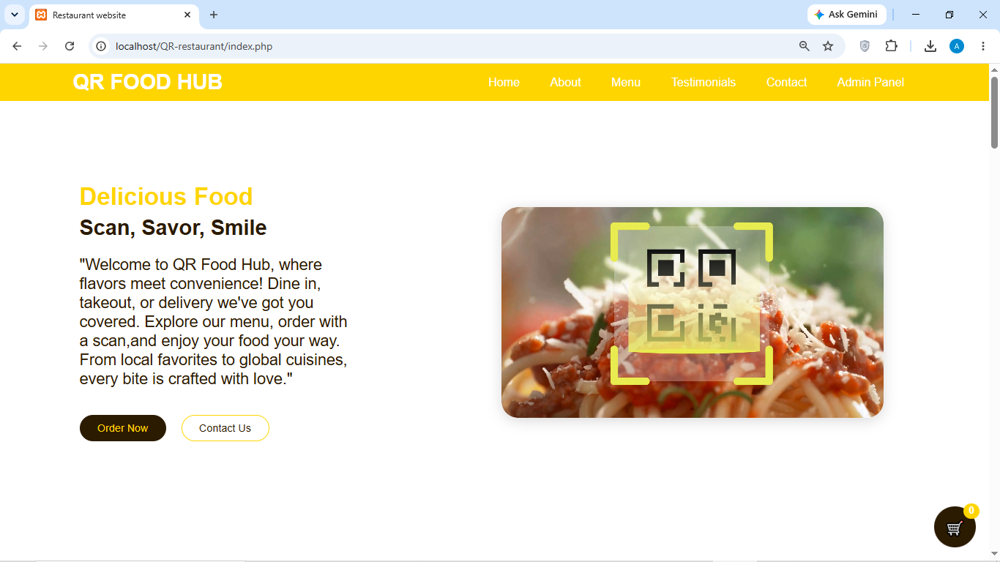
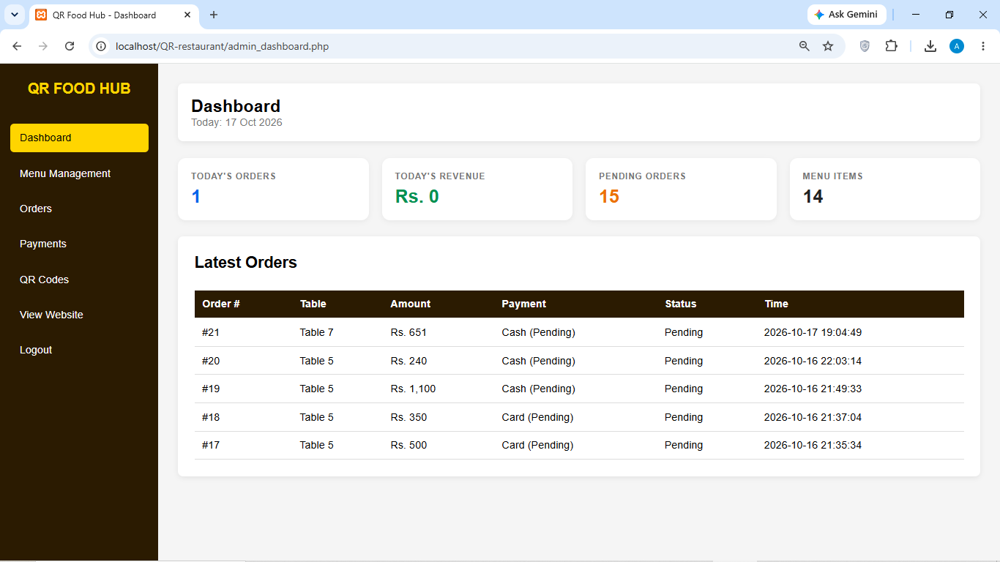
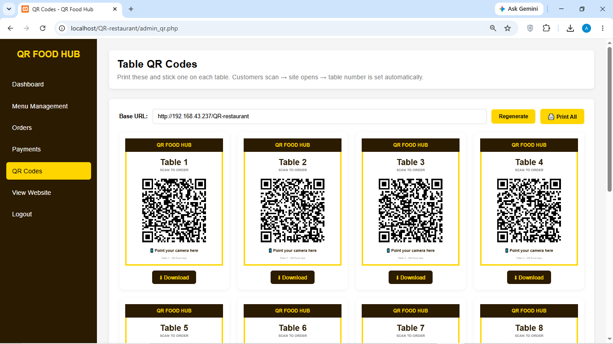

# QR Food Hub - A QR-Based Restaurant Ordering System

A full-stack web application built with PHP, MySQL, HTML, CSS, and JavaScript. 
Customers scan a QR code at their table to view the digital menu, place an order, and select a payment method. Restaurant admins get real-time alerts and can manage orders, menus, payments, and generate branded QR codes.

## Tech Stack
- Frontend: HTML5, CSS3, JavaScript
- Backend: PHP 8
- Database: MySQL (XAMPP)
- Libraries: QRCode.js, Swiper.js, Font Awesome

## How to Run
1. Move the folder to `htdocs` in XAMPP.
2. Import the database into phpMyAdmin.
3. Start Apache and MySQL.
4. Open `http://localhost/QR-restaurant/index.php`.
   ## Screenshots

### Customer Home Page

### Admin Dashboard

### QR Generator

